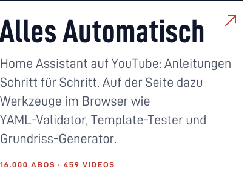
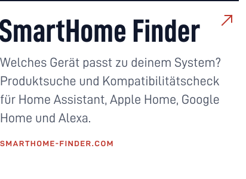
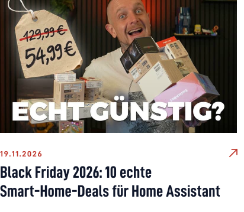
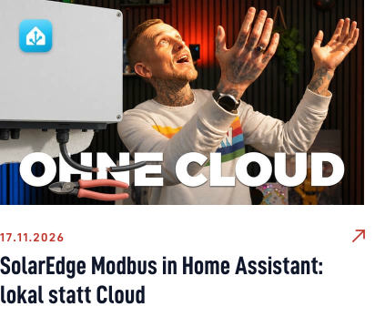
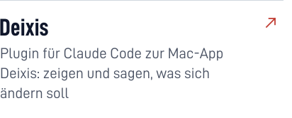
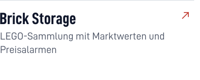
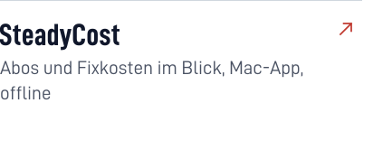
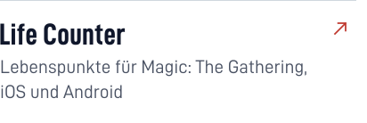

<a href="https://alles-automatisch.de"><picture><source media="(prefers-color-scheme: dark)" srcset="img/header-dark.svg"></picture></a>

<picture><source media="(prefers-color-scheme: dark)" srcset="img/section-ha-dark.svg"></picture>

<a href="https://alles-automatisch.de"><picture><source media="(prefers-color-scheme: dark)" srcset="img/alles-automatisch-dark.svg"></picture></a>
<a href="https://smarthome-finder.com"><picture><source media="(prefers-color-scheme: dark)" srcset="img/smarthome-finder-dark.svg"></picture></a>

<picture><source media="(prefers-color-scheme: dark)" srcset="img/section-videos-dark.svg"></picture>

<!-- VIDEOS:START -->

<a href="https://alles-automatisch.de/videos/black-friday-2026-deals"><picture><source media="(prefers-color-scheme: dark)" srcset="img/videos/black-friday-2026-deals-dark.svg"></picture></a>
<a href="https://alles-automatisch.de/videos/mealie-rezeptverwaltung-home-assistant"><picture><source media="(prefers-color-scheme: dark)" srcset="img/videos/mealie-rezeptverwaltung-home-assistant-dark.svg"></picture></a>
<a href="https://alles-automatisch.de/videos/solaredge-modbus-lokal"><picture><source media="(prefers-color-scheme: dark)" srcset="img/videos/solaredge-modbus-lokal-dark.svg"></picture></a>
<a href="https://alles-automatisch.de/videos/connect-aux-2-einrichten-RdSFKN"><picture><source media="(prefers-color-scheme: dark)" srcset="img/videos/connect-aux-2-einrichten-RdSFKN-dark.svg"></picture></a>

<!-- VIDEOS:END -->

<picture><source media="(prefers-color-scheme: dark)" srcset="img/section-more-dark.svg"></picture>

<a href="https://folnaro.app/"><picture><source media="(prefers-color-scheme: dark)" srcset="img/folnaro-dark.svg"></picture></a>
<a href="https://github.com/dnlbbrg/deixis-plugin"><picture><source media="(prefers-color-scheme: dark)" srcset="img/deixis-dark.svg"></picture></a>
<a href="https://brick-storage.com"><picture><source media="(prefers-color-scheme: dark)" srcset="img/brick-storage-dark.svg"></picture></a>
<a href="https://wortglut.de"><picture><source media="(prefers-color-scheme: dark)" srcset="img/wortglut-dark.svg"></picture></a>
<a href="https://steadycost.de"><picture><source media="(prefers-color-scheme: dark)" srcset="img/steadycost-dark.svg"></picture></a>
<a href="https://qrvisit.de"><picture><source media="(prefers-color-scheme: dark)" srcset="img/qrvisit-dark.svg"></picture></a>
<a href="https://life-counter.de"><picture><source media="(prefers-color-scheme: dark)" srcset="img/life-counter-dark.svg"></picture></a>

<picture><source media="(prefers-color-scheme: dark)" srcset="img/section-contact-dark.svg"></picture>

<a href="https://alles-automatisch.de"><picture><source media="(prefers-color-scheme: dark)" srcset="img/contact-site-dark.svg"></picture></a>
<a href="https://youtube.com/@alles-automatisch"><picture><source media="(prefers-color-scheme: dark)" srcset="img/contact-youtube-dark.svg"></picture></a>
<a href="https://danielboberg.de"><picture><source media="(prefers-color-scheme: dark)" srcset="img/contact-web-dark.svg"></picture></a>

